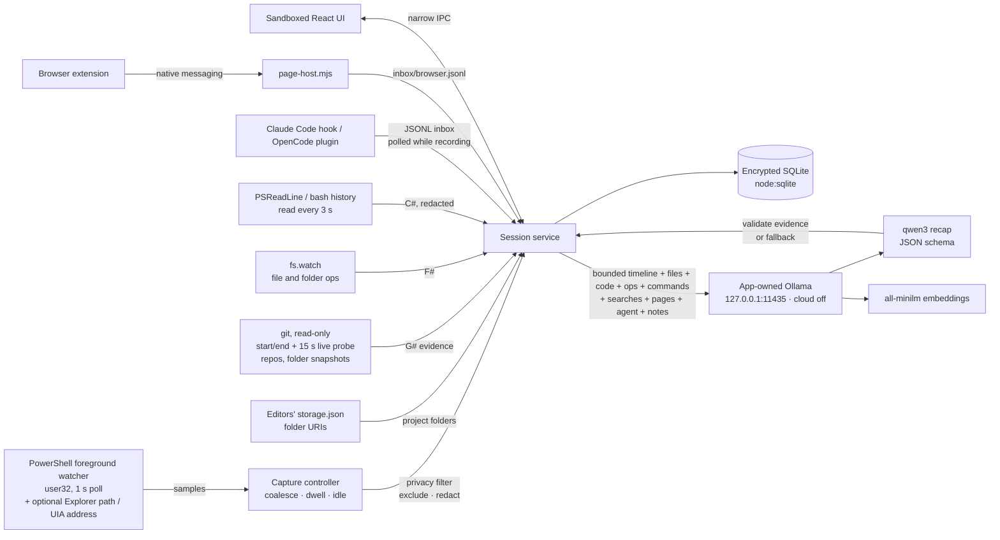

# Continuum

**Your private, on-device AI memory for unfinished work.** *Step away. Pick up where you left off.*

Continuum is a Windows desktop app for developers and other knowledge workers who lose their train of thought between interruptions. You start a named work session. With your permission, Continuum records which app is in the foreground and its (redacted) window title. Each of the following is a separate opt-in: the folder open in File Explorer, the full address in your browser, files and folders created, renamed, deleted or saved by any app, terminal commands you run (PowerShell, Git Bash), what you read on web pages (through a small browser extension), what changed in Git repositories, project folders and the projects you open in your editor, and what a coding agent (Claude Code or OpenCode) reports doing. When you end the session, a **local language model on your laptop** writes a short resume briefing: what you were doing, where you were, what changed, what you decided, and what to do next. Every claim links back to the recorded evidence. Later you can search past sessions by describing the work, correct anything the AI got wrong, or delete it.

Nothing is sent to a cloud service. Recaps, embeddings and search all run on the device and work with Wi-Fi off.

> Why local AI? The most useful signal for restoring work context is also the most private one: a continuous record of what you do on your computer. Continuum can use it only because that record never leaves the machine.


| Live session | Search memory |
|---|---|
|  |  |

## What it does

| Observe | Understand | Remember | Resume |
|---|---|---|---|
| Opt-in capture of the foreground app and redacted window title, only during a session you start. Optional, separately allowed: Explorer folder paths, full browser addresses, file and folder activity from any app, terminal commands, pages read (title, headings, excerpt, highlights), code changes (Git repositories, project folders, projects open in your editor), coding-agent reports. Pause stops every observer. | Local model (`qwen3:1.7b` by default) turns the timeline, files worked on, code changes, file operations, commands, web searches, pages read, agent reports and your notes into a schema-validated recap that cites evidence IDs (E#, G#, A#, N#, F#, C#, W#, P#). | Encrypted SQLite store. Local `all-minilm` embeddings for semantic search, with keyword fallback. An organized, non-AI **Session report** lists code changes, files and folders, commands, pages read, searches, websites and time in apps. | A Resume dashboard shows your last task, last window, files you worked on, changes in your code, where you spent time and suggested next steps. |

- **Privacy controls:** capture is off by default, and each optional category or connector is a separate permission (11 consent scopes, all in the permission history). The Privacy center has five tabs: Overview, Recording, Code & tools, Exclusions and Data. Pause and resume. Exclusions are picked from the apps on your device (password managers, messaging apps and banking/credential keywords are excluded by default), plus folders, websites and advanced keywords. Private/incognito windows are always excluded. Emails, tokens, login codes and long numbers are redacted from titles and addresses; passwords, tokens and keys are redacted from commands and page text. You can hide individual events from the AI. JSON export, per-session delete, delete everything.
- **Honest AI:** each item is labeled *Observed*, *Git change*, *Agent-reported*, *Your note* or *AI suggestion*. Invented evidence IDs are stripped, claims left without evidence are dropped, "changed" claims about files that were only viewed are dropped, and unsupported "completed/fixed" claims are rejected. The model is told never to guess what a change was from a file or project name. If nothing grounded remains, the app retries once, then shows a clearly labeled non-AI fallback recap instead. Agent reports are shown as unverified, and a command being run is not taken to mean it succeeded.
- **Visible state:** the header status pill, a tray icon and the window title always show Recording / Paused / Not recording.

## Requirements

- Windows 11 (the only tested OS), Node.js 22.12+ (tested with 24.15)
- [Ollama](https://ollama.com/download/windows) installed (tested with 0.40.2)
- Git on PATH, only if you use code-change tracking (Git repositories or project folders)
- Chrome, Edge, Brave or Chromium, only if you use page context (the extension is loaded unpacked); in development the helper runs with `node` from PATH
- About 2 GB of disk space for models. Internet is needed only for installation.

## Setup

```powershell
npm ci
ollama pull qwen3:1.7b      # default recap model (~1.4 GB)
ollama pull all-minilm      # embeddings for search (45 MB)
ollama pull qwen3:4b        # optional: higher-quality, slower recaps (2.5 GB)
npm start                   # builds the UI and launches the desktop app
```

Continuum starts its **own** Ollama server on `127.0.0.1:11435` with `OLLAMA_NO_CLOUD=1`. Your regular Ollama on port 11434 is left untouched. It uses Ollama's normal model folder, so models pulled with `ollama pull` are available. When Continuum quits, it ends the whole Ollama process tree it started (including model runner processes).

First run walks you through: what is and isn't recorded → exclusions (apps on this device, folders, websites) → local model check → capture permission (optional; without it you get notes-only mode), with the two optional capture categories offered once you allow basic capture. The same step offers three more unchecked boxes that do not depend on capture consent: editor project tracking, file and folder activity, and terminal commands. Everything else is in the Privacy center.

### Permissions

Foreground capture uses a hidden PowerShell child process that calls `user32` (`GetForegroundWindow`, `GetWindowText`, `GetLastInputInfo`) once per second. It needs no admin rights, screenshots or window contents. The watcher runs only while a session is recording and is killed on pause or end. If it can't start, Continuum falls back to notes-only mode and says so.

The two optional categories add work to that same watcher, and only when the foreground window changes:

- **File Explorer folders:** the folder path of the foreground Explorer window, read through the `Shell.Application` COM object (Windows 11 tabs are matched by title).
- **Full web addresses:** the address bar of Chrome, Edge, Brave, Firefox, Opera, Vivaldi or Arc, read through Windows UI Automation (about 450 ms per read measured on Chrome). The path and query are kept. Emails, known secret prefixes, token/code/key/password/session/signature query values, long tokens and long numbers are redacted.

### How you work (Privacy center → Recording)

Each is a separate permission, off by default, active only while a session is recording, and independent of basic capture consent.

- **Files and folders (any app):** `fs.watch` (Windows change notifications) on Desktop, Documents, Downloads, your configured and auto-tracked projects, and, when Explorer folder capture is on, the folder open in File Explorer (direct children only). Records created / deleted / renamed / modified ("Saved") with the path, never contents. A delete and a create in the same folder within 1.2 s, in either order, become one rename. `AppData\Local`, node_modules, build and cache folders, temp/lock files, Continuum's own data folder, excluded folders and keyword matches are ignored. At most 2,000 operations per session.
- **Terminal commands:** PowerShell in any host (Windows Terminal, VS Code, conhost) through PSReadLine's `*_history.txt`, and Git Bash through `~/.bash_history` (add `PROMPT_COMMAND="history -a; $PROMPT_COMMAND"` to `~/.bashrc` yourself; the app does not show this snippet yet). Read every 3 s, only for commands typed after the session started or resumed. Passwords, tokens and keys in arguments, `mysql -pPASS`, Authorization headers, credentials in URLs and secret environment assignments are redacted; a command containing an excluded keyword is dropped. cmd.exe keeps no readable history, so it is not supported (Continuum does not inject into processes). Whether a command succeeded is not known.
- **What you read on web pages:** a Manifest V3 extension in `extension/` (fixed ID `lalpcomjdkoleniaecagffkllopajcod`) reads the page title, up to 8 h1–h3 headings, the meta description, a main-text excerpt (≤1,500 chars; navigation, header, footer, aside, forms and inputs removed) and text you highlight (≤500 chars, never inside inputs). Never in incognito. It sends them through Chrome native messaging to `connectors/page-host.mjs`, which appends to the local inbox. In Privacy center → Recording, click **Register local helper** (writes a `page-host.cmd` and a host manifest to the data folder and one per-user `HKCU` registry key each for Chrome, Edge, Brave and Chromium), then load the extension unpacked from the folder shown. Continuum ingests pages only while recording; excluded sites and keywords and redaction apply. Note that the extension and helper deliver pages whenever the extension is loaded, so between sessions page records sit in the plaintext inbox file until they are discarded at the next session end, at startup, or when the option is turned off. Delete everything does not unregister the helper, and there is no unregister button yet.
- **Web searches** need no extra permission: queries are read from full addresses you already allowed (Google, Bing, DuckDuckGo, Yahoo, YouTube, GitHub, Stack Overflow, MDN, npm, Perplexity, Brave Search, Ecosia).

### Code changes and coding agents (Privacy center → Code & tools)

- **Track code changes in projects I open in my editor** (consent scope `editor-project-tracking`; turning it on also turns on changed-line excerpts): VS Code, Cursor, Windsurf and VSCodium project names are resolved to folders from the editors' own `storage.json` (folder URIs only). Projects open when the session starts, and any project the moment its window is in front, get a baseline (a Git snapshot, or a private folder snapshot). With file activity on, a file saved in a project that is not tracked yet also triggers a baseline, whatever editor saved it; in a non-Git folder that first save has no exact lines, later saves do. While recording, a "Code changes so far" panel is refreshed every 15 s (non-destructive).
- **Git (read-only):** add up to 10 repositories. Snapshots are taken at session start and end (branch, HEAD and status); while recording, the same read-only comparison also runs every 15 s for the live panel. At the end it records commits since the start (short id and subject) and per-file line counts. File contents are read only if you turn on **Include the changed lines**: up to 6 files × 40 lines, redacted, encrypted, read by the local model only, and summarized as "what changed" (e.g. `REDIRECT_URI: 3000 → 5173`). Git runs without a shell, with repository hooks, fsmonitor, external diff/textconv, pagers and credential helpers disabled.
- **Project folders (no Git needed):** add up to 10 folders. At session start Continuum takes a private snapshot inside its own data folder (never writing to your folder), compares it at the end (and every 15 s while recording, keeping the snapshot), then deletes it. node_modules, builds, binaries and `.env` files are skipped; up to 3,000 files.
- **Coding agents:** small adapters for Claude Code (hooks) and OpenCode (plugin) append minimized records to `%APPDATA%\Continuum\inbox\*.jsonl`: agent, time, hashed session id, project folder name, event, tool name, relative file path, success. Never prompts, replies, shell commands or tool output. Continuum reads the inbox only while a session is recording. **You install the adapters yourself**, which changes your own tool configuration: the Code & tools tab shows the Claude Code `settings.json` hook snippet and where to copy the OpenCode plugin file. There is no network port; the transport is a local file.

## Offline demo

1. While online: install the models above and start the app once.
2. In **Local AI**, click **Warm up model**.
3. Turn Wi-Fi off.
4. Start a session (for example "Fix authentication callback"), switch between your editor and browser docs, and add a note. With the Git connector on, make a change in a connected repository.
5. Click **End & write recap**. The recap is written on the laptop with qwen3:1.7b on an i5-13420H with no GPU. Measured: 27–34 s in the live check with Git excerpts; 39–68 s in the e2e run with every evidence kind, before the prompt budgets were trimmed (not re-measured since).
6. Open **Resume**, then **Search memory** (Ctrl+K) for "auth redirect bug". Afterwards, delete the session and search again.

The up-to-date stage script is in [docs/11_DEMO_RUNBOOK.md](docs/11_DEMO_RUNBOOK.md).

## Commands

```powershell
npm start                       # build + run
npm test                        # 34 unit tests: privacy filter, capture, sessions, validation, encryption, Git, excerpts, editor tracking, file/command/page activity, agents
npm run test:live               # real local-model recap with real Git evidence + embeddings + search + delete (synthetic data)
npm run test:e2e                # Playwright drives the real Electron app: scripted capture feed, real Git repo and project folder, real file ops, throwaway terminal history, real adapters and page helper, real model, axe audits
npm run test:browser            # real Chromium with the actual extension loaded; registers the page helper for the run, then removes it
npm run test:capture            # real Windows capture: test-owned window, Explorer folder and Edge address; own window never recorded; pause stops capture
npm run test:restart            # data and DPAPI key survive quit + relaunch
npm run test:packaged           # launches the packaged app.asar, then Continuum.exe, up to local-AI readiness
npm run package                 # unpacked Windows build: release/Continuum-win32-x64/Continuum.exe
```

The packaged executable is unsigned. On the demo laptop, Smart App Control blocks or allows unsigned rebuilds unpredictably: the latest rebuild of `Continuum.exe` was blocked ("blocked by your organization's Device Guard policy"), while the previous one launched. The packaged `app.asar` passes the smoke test under the npm Electron binary. **The demo uses `npm start`.** `test:capture` uses the real desktop: leave the computer alone for about 40 s and keep elevated windows (such as an elevated Task Manager) out of the foreground, because Windows does not let a normal process take focus from them. `connectors/` and `extension/` are unpacked outside `app.asar` so Claude Code, OpenCode and the browser can run the adapters, the page helper and the extension. Test runs use a throwaway data folder through `CONTINUUM_TEST_DIR`. `CONTINUUM_CAPTURE_FEED` replays a scripted activity file, and `CONTINUUM_HISTORY_DIR` points terminal capture at a throwaway history folder, for reproducible tests.

## Where data lives

The data folder is `%APPDATA%\Continuum\` (the Local AI screen shows the exact path). It holds `continuum.db` (SQLite), `continuum.key`, the `inbox\` folder (agent records and `browser.jsonl` page records), `snapshots\` (private project-folder snapshots, only during a session) and `browser-helper\` (only after you register the page helper). Session titles, window titles, folder paths, addresses, file operations, commands, page records, notes, recaps, Git records, agent events, the repository and project-folder lists, embedded text and vectors are encrypted with AES-256-GCM. The key is protected by Windows DPAPI through Electron `safeStorage`, with no plaintext fallback. Corrupt data fails closed. Inbox files are plaintext but short-lived: they are pruned when a session ends, cleared when the matching option is turned off, and discarded at startup. Registering the page helper also writes per-user registry keys under `HKCU\Software\…\NativeMessagingHosts\com.continuum.page_context`. Deleting runs cascades and `VACUUM`. SSD secure erase and backups outside the app cannot be guaranteed.

## Architecture



Stack: Electron 44, React 19, TypeScript, Vite 8, Node's built-in `node:sqlite`, lucide-react icons, Inter Variable (bundled), a Manifest V3 browser extension with a Node native-messaging helper, and the Node test runner plus Playwright/axe-core for tests. No telemetry, analytics or remote fonts. The renderer can load only its own packaged files.

## Limitations

- Windows only. Continuum sees window titles and, if allowed, folder paths, addresses, file-operation paths, commands, short page excerpts, Git file names, line counts and bounded changed-line excerpts, and agent reports. It does not read whole files or documents, so the model can misread intent. That is why every claim cites evidence and recaps can be edited.
- A Git change proves a file changed, not that the code works. A command being run does not mean it succeeded. Agent reports are what the agent says it did and are not verified.
- Redaction (titles, addresses, commands, page text, code excerpts) is pattern-based; unusual secret formats can slip through.
- Terminal capture covers PowerShell (PSReadLine) and Git Bash with `history -a`; cmd.exe is not supported. Page context needs the extension loaded unpacked in a Chromium-based browser (Chrome, Edge, Brave, Chromium).
- CPU-only recaps take tens of seconds. Smaller models are faster but less precise.
- Bounded context: up to 20 timeline segments (the 10 most recent plus the longest earlier ones; start pages, OS search and pickers are left out), 12 files worked on, the 12 most recent notes, up to 10 commits and 20 files per repository with at most 1,800 characters of changed lines, 30 file operations, 30 commands, 20 searches, 15 pages within 1,500 characters of page text, and the 25 most recent agent entries per recap.
- Not an employee-monitoring tool. There is no remote dashboard, sharing or sync.

## Documentation

[PRD](docs/01_PRD.md) · [TRD](docs/02_TRD.md) · [App flow](docs/03_APP_FLOW.md) · [Design brief](docs/04_DESIGN_BRIEF.md) · [Data schema](docs/05_BACKEND_DATA_SCHEMA.md) · [Implementation plan](docs/06_IMPLEMENTATION_PLAN.md) · [Decision log](docs/07_DECISION_LOG.md) · [Validation](docs/08_VALIDATION.md) · [Threat model](docs/09_THREAT_MODEL.md) · [Disclosures](docs/10_SUBMISSION_DISCLOSURES.md) · [Demo runbook](docs/11_DEMO_RUNBOOK.md)

Built during the AppBuildersPH Hackathon 2026, starting from an empty workspace on 9 October 2026, with AI coding assistance (disclosed in [docs/10](docs/10_SUBMISSION_DISCLOSURES.md)).
